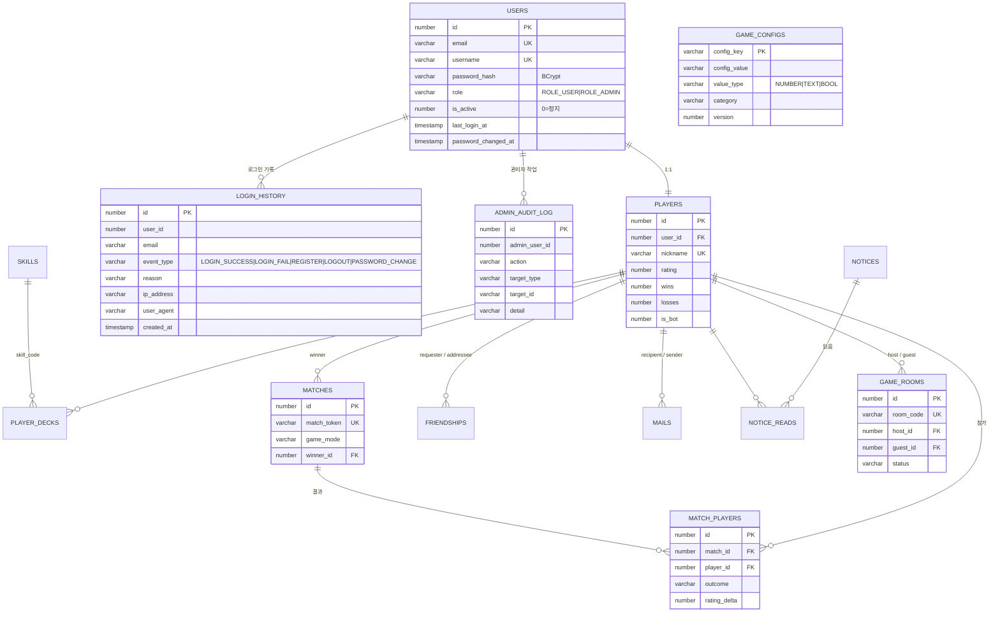
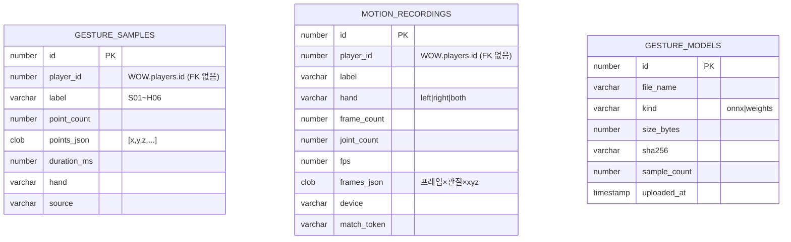

# War of Wizards — DB 설계서

Oracle XE 21c (`localhost:1521/XEPDB1`) 안에 **계정 2개 = DB 2개**를 둡니다.

| | ① 통합 DB | ② 모션 DB |
|---|---|---|
| Oracle 계정 | `WOW` / `wow1234` | `WOW_MOTION` / `wow1234` |
| 담는 것 | 회원 · 로그인 기록 · 플레이어 · 덱 · 전적 · 친구 · 우편 · 룸 · 관리자 기록 · 게임 설정 | 제스처 학습 샘플 · VR 손 모션 녹화 · AI 모델 이력 |
| 특징 | 작고 자주 조회, 관계(외래키)가 많음 | 좌표 수천 개짜리 큰 데이터(CLOB), 쓰기가 잦음 |
| Spring 설정 | `spring.datasource.*` | `wow.motion.datasource.*` |
| Java 패키지 | `com.wow.entity`, `com.wow.repository` | `com.wow.motion.entity`, `com.wow.motion.repository` |
| 트랜잭션 | `@Transactional` (기본) | `@Transactional(transactionManager = MotionDbConfig.TX)` |

**왜 나눴나:** 모션 데이터는 금방 수백 MB 로 커집니다. 회원 DB 와 분리하면 백업·삭제·용량 관리를 따로 할 수 있고,
나중에 모션 DB 만 다른 서버로 옮길 수 있습니다(`WOW_MOTION_DB_URL` 만 바꾸면 됨).
두 DB 는 외래키로 묶을 수 없으므로 모션 테이블에는 `player_id` 숫자만 저장합니다.

## 설치 · 연결 순서

```
Database/oracle/setup-oracle.bat          ① 계정 2개 생성 (sqlplus / as sysdba, 여러 번 실행해도 안전)
SpringServer/run-server.bat               ② 서버 시작 → 테이블·인덱스 자동 생성(JPA) → 한글 설명·enum 제약 자동 적용
```

| 파일 | 역할 |
|---|---|
| `oracle/setup-oracle.bat` | 아래 SQL 2개를 차례로 실행 |
| `oracle/01_create_accounts.sql` | WOW · WOW_MOTION 계정 생성 (이미 있으면 잠금 해제만) |
| `oracle/02_move_old_gestures.sql` | 예전 버전(통합 DB 안에 제스처가 있던 구조)에서 올릴 때 데이터 이동 |
| `oracle/99_drop_accounts.sql` | 두 계정과 모든 데이터 삭제 (되돌릴 수 없음) |
| `oracle/schema/10_main_tables.sql` · `20_motion_tables.sql` | 실제 DB 에서 추출한 테이블 정의(참고용 DDL) |

서버 쪽 연결 코드:

| 코드 | 하는 일 |
|---|---|
| `config/MainDbConfig.java` · `MotionDbConfig.java` | DataSource · EntityManager · 트랜잭션 매니저를 DB 마다 하나씩 |
| `init/DatabaseInitializer.java` | 시작할 때 두 DB 연결·테이블 목록을 로그에 출력, Oracle 이면 한글 설명(COMMENT) 적용, enum CHECK 제약을 Java enum 과 맞춤 |
| `resources/db/oracle/main-comments.sql` · `motion-comments.sql` | 테이블·컬럼 한글 설명 (SQL Developer 에서 보임) |
| `config/DatabaseConnectionFailureAnalyzer.java` | 연결 실패 시 원인과 해결 방법을 한글로 안내 (ORA-01017, ORA-12541 …) |

> enum CHECK 제약: JPA 는 enum 컬럼에 `CHECK (col in ('A','B'))` 를 만들지만, 나중에 enum 값을 추가해도 기존 제약을 고치지 않아
> 새 값 저장이 ORA-02290 으로 실패합니다. `DatabaseInitializer.ENUM_COLUMNS` 에 등록된 컬럼은 서버 시작 때 자동으로 맞춰집니다.

## ① 통합 DB (WOW)



| 테이블 | 설명 | 주요 규칙 |
|---|---|---|
| `users` | 로그인 계정 | 이메일·아이디 중복 불가, 비밀번호는 BCrypt 해시만 저장, `is_active=0` 이면 로그인 불가 |
| `players` | 게임 프로필 (users 1:1, 봇은 user 없음) | 닉네임 2~12자 중복 불가, 레이팅 시작 1000 |
| `player_decks` | 마법서 덱 | 8장, 중복 불가, 고위력(H01~H06) 최대 2장 |
| `skills` | 스킬 19종 마스터 | 서버 시작 시 자동 입력 |
| `matches` · `match_players` | 대전 1판과 참가자별 결과 | `match_token` 으로 같은 결과 중복 기록 방지 |
| `friendships` | 친구 요청/관계 | (requester, addressee) 쌍 중복 불가 |
| `mails` · `notices` · `notice_reads` | 우편·초대·보상 / 공지 / 공지 읽음 | |
| `game_rooms` | 친선전 룸 | 6자리 코드 = Photon 룸 이름, 웹 대기실(게스트·준비) |
| `login_history` | 로그인·가입·로그아웃·비밀번호 변경 기록 | 15분 안에 LOGIN_FAIL 5번이면 로그인 잠금 |
| `admin_audit_log` | 관리자 작업 기록 | 회원 정지·권한·비밀번호 초기화·설정 변경·실시간 전송 |
| `game_configs` | 게임 설정 (쿨타임·웨이브·점검 모드·이벤트 배율 …) | 바꾸면 Unity/웹에 실시간 전달, `version` 1씩 증가 |

## ② 모션 DB (WOW_MOTION)



| 테이블 | 넣는 곳 → 쓰는 곳 |
|---|---|
| `gesture_samples` | Unity 룬 그리기(`POST /api/gestures/samples`) → Python 학습(`GET /api/server/gestures/samples`) |
| `motion_recordings` | Unity 핸드 트래킹 녹화(`POST /api/motions`) → Python(`GET /api/server/motions`), 관리자 페이지 |
| `gesture_models` | Python 모델 업로드(`POST /api/server/gestures/model`) 때마다 이력 1줄 |

`WOW` 계정에도 모션 테이블 읽기 권한이 있어 SQL Developer 에서 `SELECT * FROM wow_motion.motion_recordings` 로 볼 수 있습니다.

## 자주 쓰는 SQL (SQL Developer, WOW 계정)

```sql
-- 오늘 로그인 실패가 많은 계정
SELECT email, COUNT(*) FROM login_history
 WHERE event_type = 'LOGIN_FAIL' AND created_at > TRUNC(SYSDATE) GROUP BY email ORDER BY 2 DESC;

-- 레이팅 TOP 10
SELECT nickname, rating, wins, losses FROM players WHERE is_bot = 0 ORDER BY rating DESC FETCH FIRST 10 ROWS ONLY;

-- 스킬별 제스처 샘플 수 (모션 DB)
SELECT label, COUNT(*) FROM wow_motion.gesture_samples GROUP BY label ORDER BY label;
```
